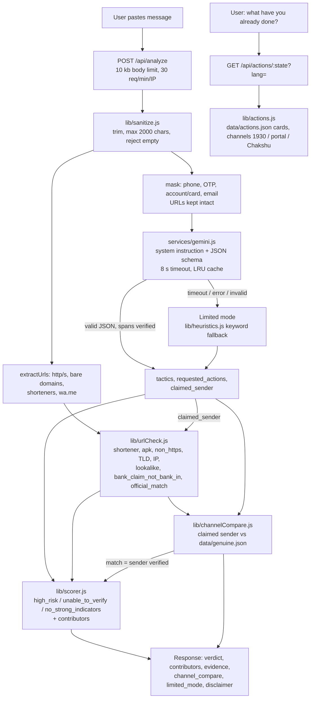

# Architecture

Xotorko is a single Express app. Gemini reads the manipulation in a message. Deterministic code owns everything a user acts on: link checks, the verdict, advice and phone numbers.

## Modules

| Module | Role | Uses AI? |
|---|---|---|
| `lib/sanitize.js` | Validate input, mask PII before Gemini, extract URLs | No |
| `services/gemini.js` | Structured analysis of manipulation tactics | Yes |
| `lib/heuristics.js` | Keyword fallback, **limited mode only** | No |
| `lib/entities.js` | Read-only lookups over `data/genuine.json` | No |
| `lib/urlCheck.js` | Deterministic link signals | No |
| `lib/channelCompare.js` | Claimed sender vs official domains / SMS sender ID | No |
| `lib/scorer.js` | Rules → verdict + contributors | No |
| `lib/actions.js` | Vetted next-step cards from `data/actions.json` | No |
| `lib/analyze.js` | Orchestrates the pipeline (shared by the API and `scripts/eval.js`) | — |
| `routes/api.js`, `server.js` | HTTP, security headers, rate limiting, errors | — |

## Limited mode

If `GEMINI_API_KEY` is missing, or the Gemini call times out (8 s), errors, or returns JSON that fails the schema, `analyzeMessage` returns `null`. The pipeline then uses keyword pseudo-tactics and guesses the claimed sender from entity names in the text. In limited mode `requested_actions` comes from `detectRequestedActions`, which looks for three asks only: `share_otp`, `make_payment`, and `call_number` (a call/contact verb within 60 characters of a phone number). The patterns are kept narrow and skip negated phrases, because the first two are "dangerous" in the scorer. The response sets `limited_mode: true`. The URL engine, scorer and channel compare run the same way in both modes.

## Data ownership

`data/genuine.json` and `data/actions.json` are hand-verified and read-only at runtime. Gemini never produces domains, phone numbers or advice.
